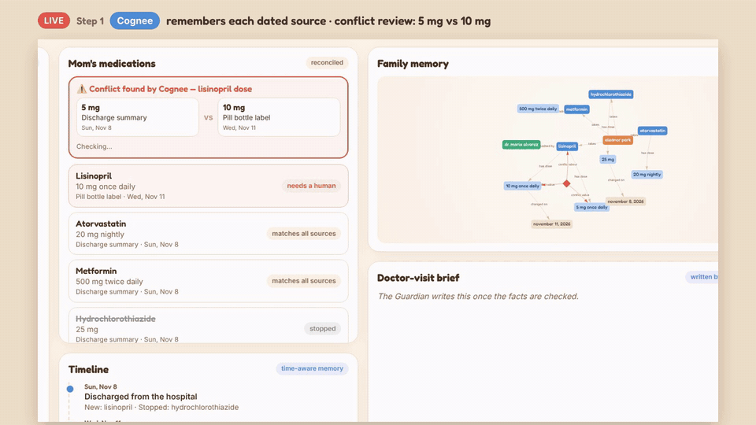
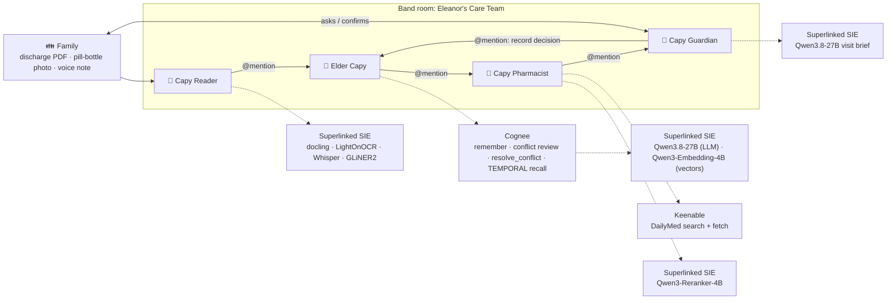
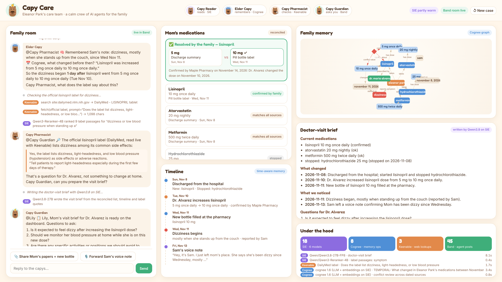

# 🐹 Capy Care

**A calm crew of AI agents that keeps Mom's medications straight.**

When an aging parent comes home from the hospital, the family is left reconciling discharge papers, new pill bottles and a group chat of symptoms, and mistakes are common: one study found 65% of patients left the hospital with a discrepancy in their medication records. Capy Care is a team of four AI agents that does one real job for the family: **medication reconciliation**. They read every document, photo and voice note with **Superlinked SIE**, remember each fact with its date and catch contradictions in a **Cognee** knowledge graph, check the official drug label on the live web with **Keenable**, and work alongside the family in a shared **Band** room. Nothing changes without a person saying yes, and the crew finishes with a doctor-visit brief the family can bring to the appointment.



📽️ Demo video (2:26): [`demo/capy-care-demo.mp4`](demo/capy-care-demo.mp4) · subtitles [`.srt`](demo/capy-care-demo.srt) · 🗂️ Pitch: [`pitch.pdf`](pitch.pdf) ([HTML](pitch.html)) · ❓ [FAQ](FAQ.md) · 🎤 [Presenter script](DEMO.md) · 🐹 Mascot: [`brand/capy-crew.png`](brand/capy-crew.png)

## Sponsors at a glance

| Sponsor | Role in Capy Care | What we use |
|---|---|---|
| **Superlinked SIE** ⭐ | Every model in the product: reading, extraction, ranking, writing, **and Cognee's own LLM and embeddings** | Serverless `extract` (docling, LightOnOCR-2-1B, Whisper large-v3 turbo, GLiNER2 entities + schema mode), `score` (Qwen3-Reranker-4B), `encode` (Qwen3-Embedding-4B), `generate` (Qwen3.8-27B with tool calling) |
| **Cognee** ⭐ | The family's memory: what was true, when, according to whom | `remember()` with dated sources, `improve(review_conflicts=True)` → `FactConflict`, `resolve_conflict()` with the family's reason, `recall()` with `TEMPORAL` and `GRAPH_COMPLETION`, graph export for the dashboard |
| **Keenable** | Live, citable evidence from the official drug label | `/v1/search` on `dailymed.nlm.nih.gov` and `/v1/fetch` with a prompt that keeps only the relevant label sections |
| **Band** | The room where the four agents and the family work together | 4 registered agents on `band-sdk`, @mention handoffs, `thought` / `tool_call` events you can watch, Human API for the family's messages |

## How it works



**SIE senses, Cognee remembers.** Small specialist models on SIE turn messy inputs into clean, dated facts without an LLM. Cognee stores those facts in a temporal knowledge graph that notices when two dated sources disagree. The Band room keeps the family in the loop, and Keenable grounds every claim in the official label.

### The demo scenario (all fictional data)



1. **Lily shares Mom's discharge summary and a photo of the new pill bottle.** Capy Reader runs docling on the PDF (1.3 s) and LightOnOCR on the photo (1.4 s), then GLiNER2 pulls each medication, dose, frequency and status (`STOP`, `NEW`) with no LLM.
2. **Elder Capy remembers both sources with their dates** (Nov 8 and Nov 11) and runs Cognee's conflict review, which creates a `FactConflict`: *lisinopril `has_dose` 5 mg once daily vs 10 mg once daily*.
3. **Capy Pharmacist reads the official lisinopril label live with Keenable**, and SIE's reranker picks the evidence: *"The recommended starting dose in adult patients with hypertension taking diuretics is 5 mg once per day."* Both doses are plausible and no prescriber note explains the change, so **Capy Guardian asks Lily to call the pharmacy** before Mom's next dose.
4. **Lily replies: "Dr. Alvarez increased it to 10 mg at Mom's follow-up on November 10."** GLiNER2 reads the reply, and Elder Capy calls `resolve_conflict()`. The conflict is now resolved by the family (`resolution_source = user`), and Cognee keeps that decision on every future review.
5. **Lily forwards Sam's voice note: "She's been dizzy since Wednesday."** Whisper transcribes it (1.0 s), and Cognee's `TEMPORAL` recall answers *"Lisinopril was increased from 5 mg once daily to 10 mg once daily."* The dizziness began one day after the increase. Keenable finds *"Dizziness: High Dose 19%, Low Dose 12%"* on the label, and Qwen3.8 on SIE writes a one-page visit brief with three questions for the doctor.

## Superlinked SIE (serverless)

Every model call in Capy Care goes to SIE serverless at `https://api.superlinked.com`; nothing runs locally and no GPU is needed. Calls go through `sie_sdk.SIEClient` and SIE's OpenAI-compatible endpoints. All of them are wrapped in one timed helper ([`capycare/sie.py`](capycare/sie.py)) that feeds the dashboard's "Under the hood" panel.

| Primitive | Model | Used for | Warm latency we measured |
|---|---|---|---|
| `extract` | `docling` | Discharge summary PDF → markdown (tables intact) | 1.3 s |
| `extract` | `lightonai/LightOnOCR-2-1B` | Pill-bottle photo → text (falls back to Qwen3.8 vision if slow) | 1.1–1.4 s |
| `extract` | `openai/whisper-large-v3-turbo` | Sibling's voice note → transcript | 1.0 s |
| `extract` | `fastino/gliner2-large-v1` | Entities, plus JSON-schema extraction of each medication fact, the document's type and date, and the family's confirmation, with **no LLM** | 0.3–0.6 s per call |
| `score` | `Qwen/Qwen3-Reranker-4B` | Ranks DailyMed label passages for the question at hand | ~0.4 s |
| `encode` | `Qwen/Qwen3-Embedding-4B` | **Cognee's vector embeddings** via SIE's `/v1/embeddings` | — |
| `generate` | `Qwen/Qwen3.8-27B-FP8` | **Cognee's LLM** (graph extraction, conflict review, recall answers) and the doctor-visit brief, via `/v1/chat/completions` | 1–10 s |

Two things we learned and built around: serverless cold starts can be long (our first OCR call took ~200 s), so the app warms every model at startup. And GLiNER2's schema mode accepts string fields only, so each medication is extracted from its own table row.

## Cognee

We run **open-source Cognee 1.6.8 inside our container, configured so that every LLM and embedding call goes to Superlinked SIE**: Qwen3.8-27B through the `custom` LLM provider with the `instructor` structured-output backend, and Qwen3-Embedding-4B through the `openai_compatible` embedding provider (see [`.env.example`](.env.example)). The memory code is in [`capycare/memory.py`](capycare/memory.py).

- **Dated sources.** Every source becomes a `DataItem` whose `external_metadata` carries its `effective_date` (discharge Nov 8, pill bottle Nov 11, pharmacy call Nov 10, voice note Nov 11). `remember()` builds the graph with a custom extraction prompt (`takes`, `has_dose`, `prescribed_by`, `reports_symptom`).
- **Conflict review.** `improve(review_conflicts=True)` finds that two dated sources disagree on lisinopril's `has_dose` and stores a `FactConflict` that cites both source chunks. `list_conflicts()` feeds the red conflict card on the dashboard.
- **The family's decision.** After the pharmacy call, `resolve_conflict(selected_fact_id=…, reason="Confirmed by Maple Pharmacy…")` marks 10 mg as current with `resolution_source = "user"`, and Cognee keeps that decision on every later review.
- **Time-aware recall.** `recall(..., query_type=SearchType.TEMPORAL)` answers "what changed in her medications before the dizziness started?" from `Timestamp` nodes, which is how the crew links the symptom to the dose change.
- **Graph view.** The dashboard draws Cognee's entity graph (patient, medications, doses, prescriber, symptom, dates, and the conflict diamond) from the dataset's graph engine.

We were given a Cognee Cloud tenant; we chose the open-source library so Cognee itself could run on SIE models. The same operations map to Cognee Cloud's REST API (`/remember`, `/improve`, `/conflicts`, `/recall`).

## Keenable

Capy Pharmacist never states a medical fact from memory. [`capycare/labels.py`](capycare/labels.py) calls `POST /v1/search` with `site: dailymed.nlm.nih.gov` to find the official FDA label, then `GET /v1/fetch` with a `prompt` such as *"Does the label list dizziness or low blood pressure as side effects? Quote the relevant sentences."* Keenable returns only the matching label sections in about 1.5 s. SIE's reranker then picks the two passages to quote in the Band room.

## Band

The four capybaras are real Band agents, registered through the Human API (`POST /api/v1/me/agents/register`) and run with `band-sdk` (`Agent.create(...)` and a `SimpleAdapter` subclass per agent; see [`capycare/crew.py`](capycare/crew.py)).

- Agents wake only when @mentioned and hand work to each other by @mention.
- Each agent posts its reasoning as `thought` and `tool_call` events, so the family can watch the crew work.
- The family's messages go through the Human API ([`capycare/band_api.py`](capycare/band_api.py)), and the dashboard mirrors the room live.
- Every new case opens a fresh room, "Eleanor's Care Team", with the four agents.
- On Band's free plan, file transfer is off, so shared documents live in a local vault and only the conversation goes through Band. The plan's limit of 5 concurrent agents is why the crew has four.

## Safety by design

- Capy Care **flags and prepares; it never gives medical advice**. Any medication change needs a person's confirmation, recorded with who confirmed it and why.
- Every claim about a drug quotes the official label, with its source.
- All demo documents, names and voices are **synthetic**; the patient is fictional.

## Run it

```bash
uv venv --python 3.13 .venv
uv pip install --python .venv/bin/python -r requirements.txt
cp .env.example .env   # then fill in your keys and the four Band agent IDs/keys
.venv/bin/uvicorn capycare.app:app --port 8000
```

Open http://localhost:8000 and click **Share Mom's papers + new bottle**, then answer Capy Guardian in the reply box, then **Forward Sam's voice note**. Each click starts a real run through Band, SIE, Cognee and Keenable.

## Repo map

| Path | What it is |
|---|---|
| `capycare/crew.py` | The four Band agents and their handoffs |
| `capycare/sie.py` | All Superlinked SIE calls (extract, score, encode, generate) |
| `capycare/memory.py` | Cognee memory: dated remember, conflict review, resolve, temporal recall, graph |
| `capycare/labels.py` | Keenable label search and fetch |
| `capycare/band_api.py`, `capycare/app.py` | Band Human API client, FastAPI server and room mirror |
| `web/` | The capybara dashboard |
| `demo/` | Synthetic demo documents and the voice note |
| `pitch.html`, `pitch.pdf` | 4-slide pitch |
